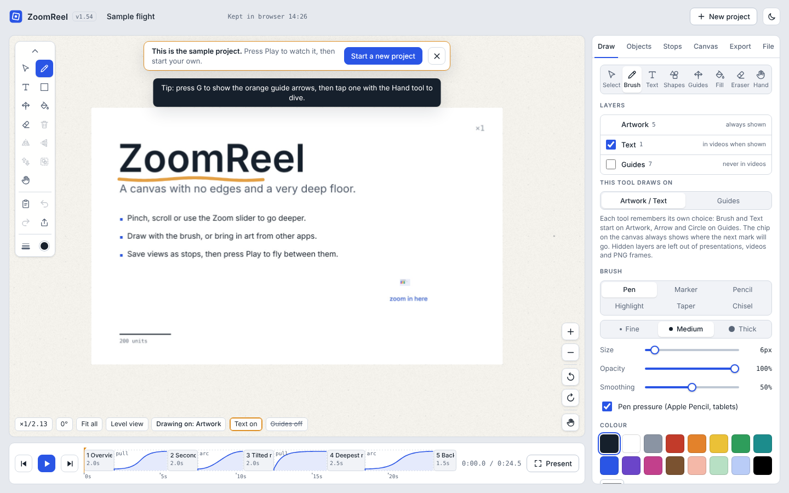
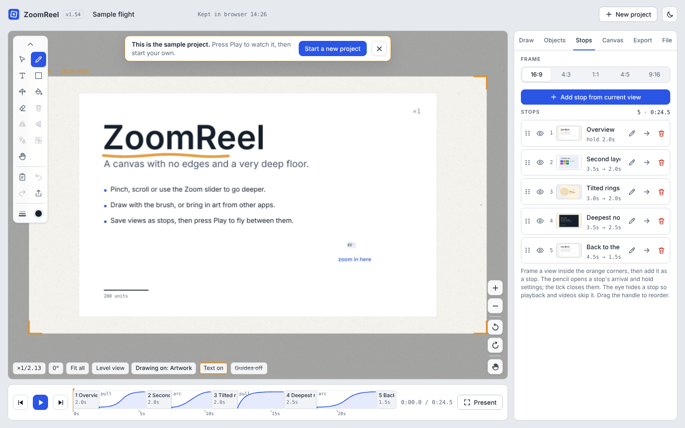
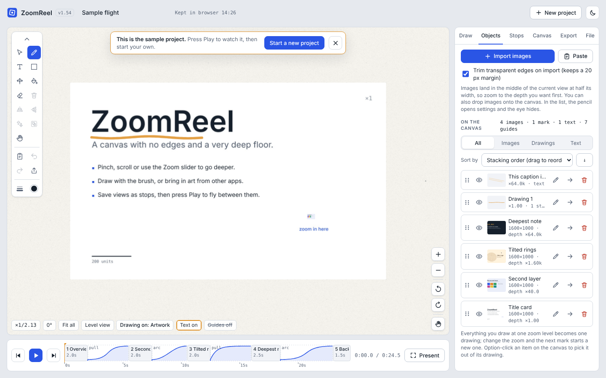
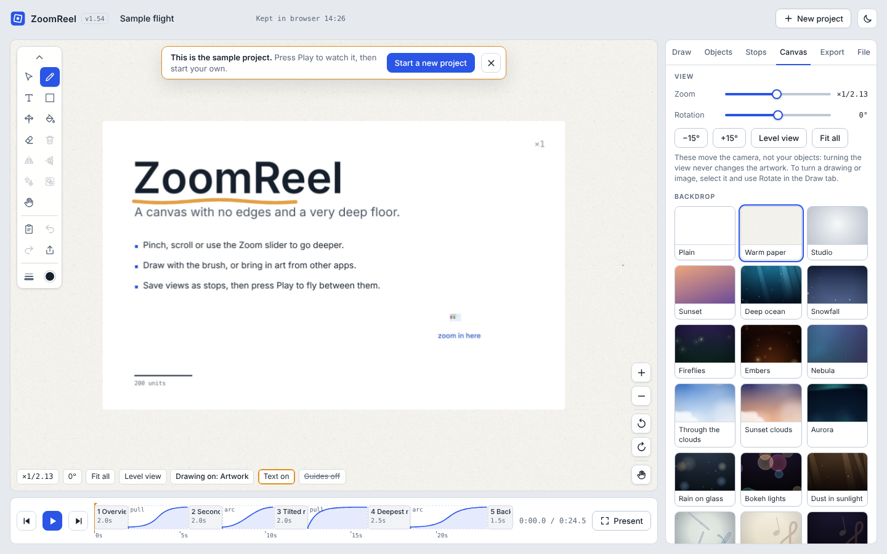
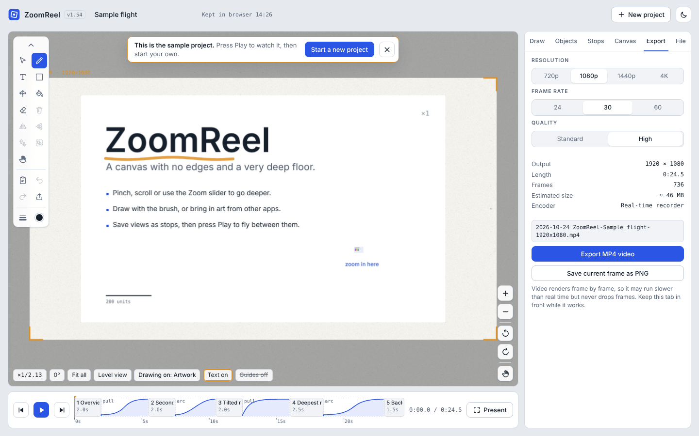
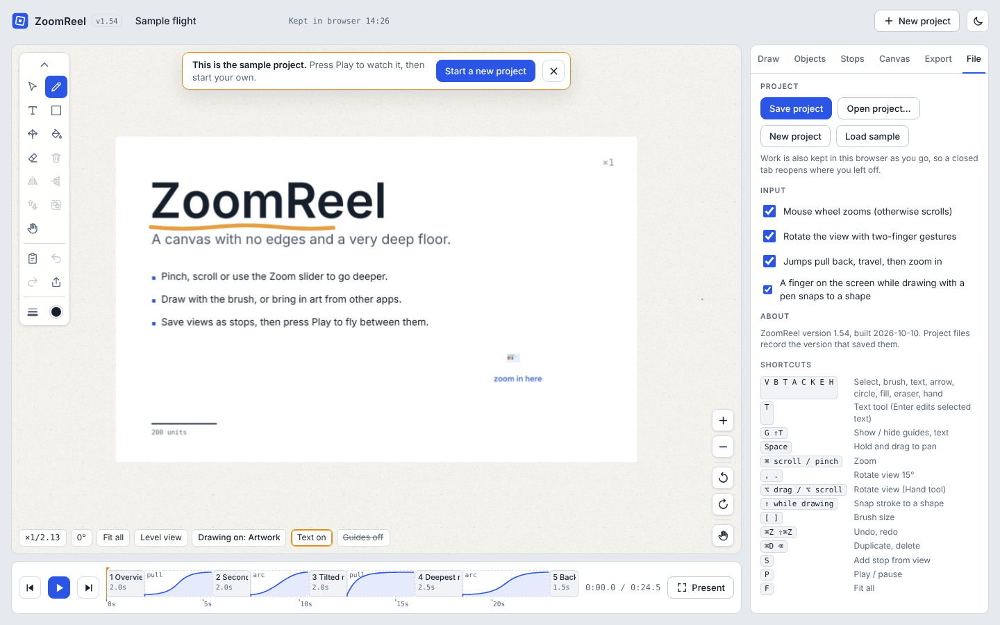
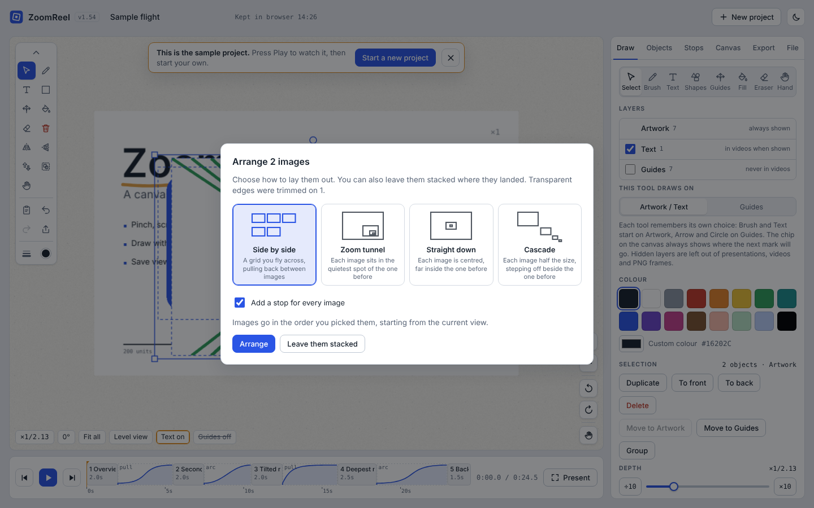
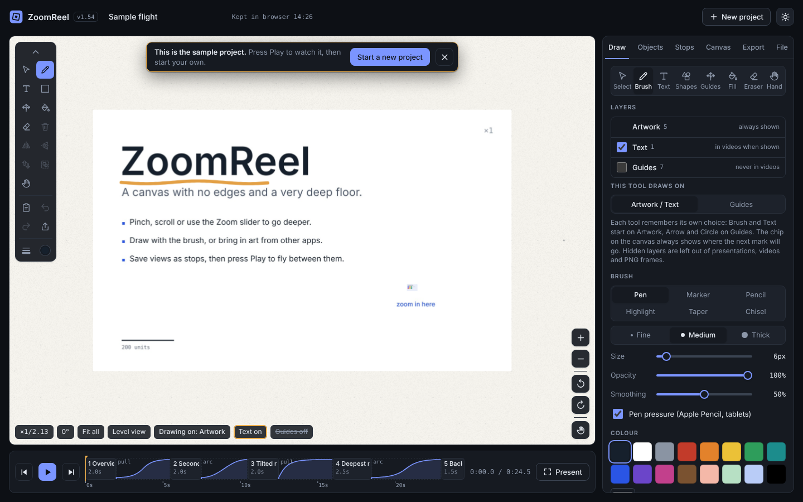
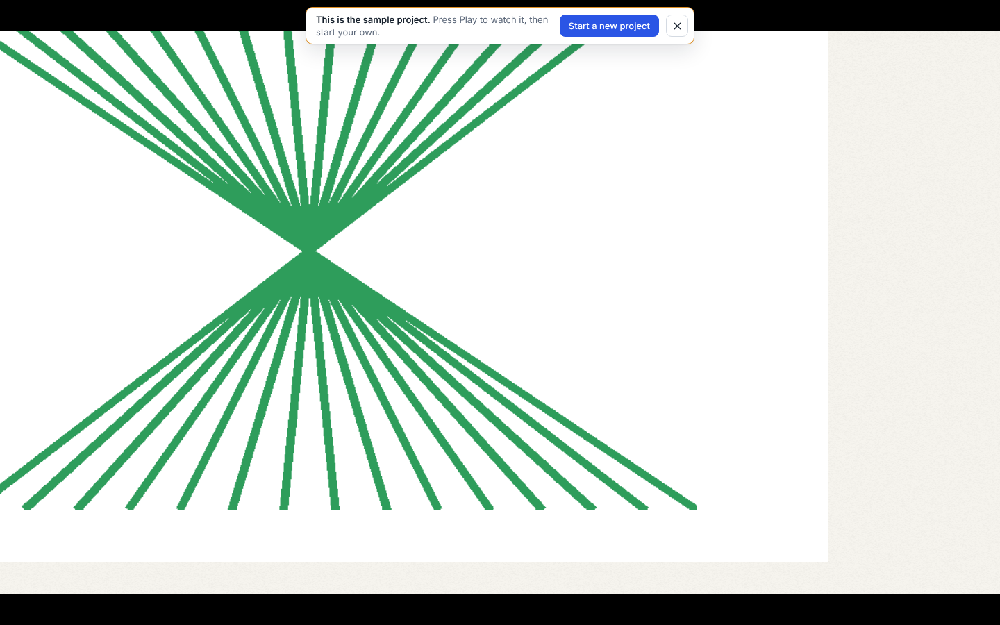

# ZoomReel

**ZoomReel is a drawing board with no edges, where you can zoom in forever, save the views you like as "stops", and then play them back as a smooth, camera-style tour.** It runs in a web browser, needs no installation, and can export your tour as an MP4 video file.



Think of it as a map you can keep zooming into. A sketch made at normal size can have a photo hidden inside it, which in turn holds a tiny note only visible when you are very close. ZoomReel is built for that kind of layered picture.

---

## Contents

- [What you can do with it](#what-you-can-do-with-it)
- [Quick start](#quick-start)
- [Screenshots](#screenshots)
- [Requirements](#requirements)
- [Repository layout](#repository-layout)
- [Documentation](#documentation)
- [Development](#development)
- [Version history](#version-history)
- [Licence](#licence)

---

## What you can do with it

- **Draw at any depth.** Brushes (pen, marker, pencil, highlighter, taper, chisel), 21 ready-made shapes, a fill tool that colours in closed outlines, an eraser and text labels.
- **Zoom without limit.** Pinch, scroll or use the on-screen + and − buttons. Each zoom level is called a *depth*.
- **Import pictures and animations.** Pictures (PNG, JPEG, WebP, GIF) and animated files can be placed anywhere, at any depth. Transparent edges can be trimmed away automatically. Several pictures can be arranged in one go in four different layouts.
- **Save stops and play them.** A *stop* is a saved view. Put stops in order, choose how the camera moves between them (pull back, direct, or along an arc), and press Play.
- **Present full screen.** Presenting glides to the first stop and then plays the whole tour.
- **Export.** Save the current view as a PNG picture (a still image), or the whole tour as an MP4 video (a video file).
- **Work in light or dark mode.** A switch in the top bar changes the whole app.
- **Keep your work.** The app remembers your last session in the browser, and you can save a project file to keep it safe.

The full, plain-English guide is in the [User Manual](docs/USER_MANUAL.md).

---

## Quick start

1. Download or clone this repository.
2. Double-click **`ZoomReel.html`**. It opens in your web browser (Safari, Chrome or Edge).
3. You will see a sample project. Press the **Play** button under the canvas to watch it.
4. Press **Start a new project** (or **New project** in the top bar) when you are ready to make your own.

There is nothing to install. The app is a single file, so you can also copy it to a USB stick or email it.

> **Internet connection:** the first time the app opens, it fetches its lettering (fonts) and the MP4 video encoder from public web servers. After that, the editor still works offline in most browsers, but video export needs the encoder, so keep the connection on when exporting for the first time in a session.

---

## Screenshots

| | |
|---|---|
| **Stops tab.** Each stop is a saved view, with its timing and easing. |  |
| **Objects tab.** Every image, drawing and text label, with eye, edit, zoom and delete buttons. |  |
| **Canvas tab.** Pick a backdrop, from plain paper to crinkled paper, maps and starfields. |  |
| **Export tab.** Choose the resolution, frame rate and quality before making an MP4 video. |  |
| **File tab.** Save and open projects, and see the keyboard shortcuts. |  |
| **Arranging several pictures.** Pick a layout and the app places them for you. |  |
| **Dark mode.** One switch in the top bar. |  |
| **Presenting.** Full screen, with the player bar hidden until you need it. |  |

---

## Requirements

| What | Needed |
|---|---|
| Web browser | A recent version of Safari (Mac and iPhone/iPad), Chrome, or Microsoft Edge |
| Computer | Any Mac, Windows PC, iPad or iPhone that runs one of the browsers above |
| Internet | Only for the first load of fonts and the video encoder |
| Installation | None |

ZoomReel is designed mainly for **Safari on a Mac** and **Safari on iOS**. It also works in Chrome and Edge. Where a browser lacks a feature, the app falls back to a slower method or explains what to do instead.

---

## Repository layout

```
ZoomReel/
├── ZoomReel.html              The whole application (one file)
├── README.md                  This file
├── docs/
│   ├── USER_MANUAL.md         Step-by-step guide for people using the app
│   ├── DESIGN_NOTES.md        Decisions made while building the app
│   └── images/                Screenshots used in these documents
├── tools/
│   └── make_screenshots.py    Regenerates the screenshots from the app
├── CHANGELOG.md               What changed in each version
├── CONTRIBUTING.md            How to report problems and suggest changes
├── LICENSE                    The licence (MIT)
├── .gitignore                 Files Git should ignore
└── .github/                   Templates for issues and pull requests
```

---

## Documentation

- **[User Manual](docs/USER_MANUAL.md):** how to use every part of the app, explained step by step.
- **[Design Notes](docs/DESIGN_NOTES.md):** why things work the way they do.
- **[Changelog](CHANGELOG.md):** the list of changes from one version to the next.

---

## Development

ZoomReel is a single HTML file containing its styles, its scripts and a small amount of built-in data. There is no build step and no package to install.

To change the app, edit `ZoomReel.html` in any text editor. Each release raises the version number in the line that reads `const APP_VERSION = '…'`. The version appears in the top bar and in the File tab.

To regenerate the screenshots after a visual change:

```bash
pip install playwright pillow
playwright install chromium
python3 tools/make_screenshots.py
```

Contributions and bug reports are welcome. Please read [CONTRIBUTING.md](CONTRIBUTING.md) first.

---

## Version history

The current version is **1.54**. See [CHANGELOG.md](CHANGELOG.md) for the full history.

---

## Licence

ZoomReel is released under the MIT Licence. You may use, copy, change and share it, including in commercial work, as long as the copyright notice travels with it. See [LICENSE](LICENSE).
